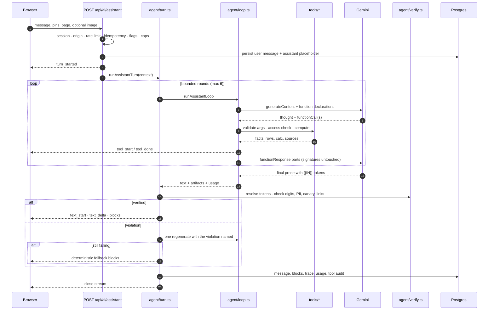
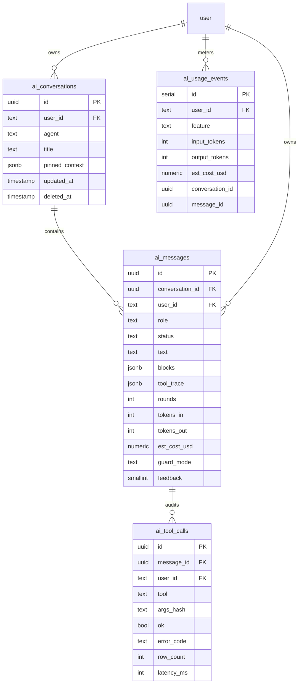
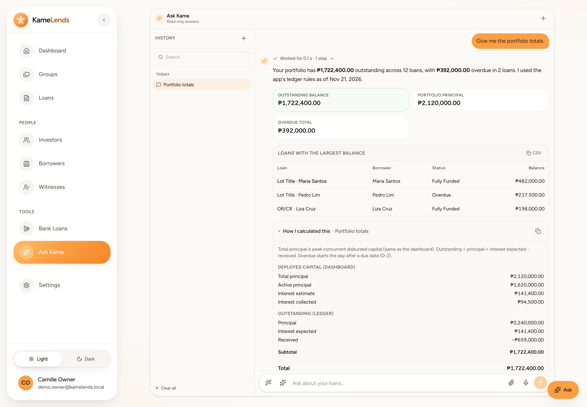

# AI assistant (Ask Kame)

Part of [`docs/PROJECT.md`](../PROJECT.md). Plan and task list:
[`workflow/for-testing/ai-assistant-chatbot.md`](../workflow/for-testing/ai-assistant-chatbot.md).
Platform gateway: [`ai-platform.md`](./ai-platform.md). Money rules: [`money-model.md`](./money-model.md).

Ask Kame answers plain-language questions about the lending data a signed-in user can already see. It is read-only, streams its working steps, shows the math, and links back to the records it used. It is also the reference integration for future AI features: the same gateway, tool layer, verifier, eval harness, and chat shell are reusable.

## Design principles

1. **The model never does arithmetic and never types a number.** Tools compute values with the existing money engine (`src/lib/money/ledger.ts`). They register facts with ids (`f1`, `f2`). The model writes `{{f12}}`; the server substitutes the display string. A verifier rejects any digit the model wrote itself.
2. **The assistant sees exactly what the user sees.** Same cached loaders, same viewer scoping, same group projection, same private-commission rule. Scope comes from the session, never from the prompt or the model.
3. **Read-only, structurally.** No write tool exists. The registry refuses `capability: "write"` and `"propose"`. `bun run check:ai-tools` blocks DB writes, network, fs, and env access inside `src/lib/server/ai/tools/`.
4. **Show the work.** Every money answer can expand into a calculation trace: formula, inputs, source records, rounding rule, and an "as of" date, built from ledger fields.
5. **Fail closed.** If prose cannot be verified, the UI shows a deterministic fallback built from tool facts (stats, tables, calc trace) instead of unverified text.
6. **One gateway.** Every model call goes through `src/lib/server/ai/`. `bun run check:ai-gateway` still enforces the single transport.
7. **Additive only.** New tables, routes, and modules. Existing money code and loaders are read, not edited. Flag off costs nothing at runtime.

## Architecture

```
Browser (Svelte 5)                    SvelteKit server (Vercel, sin1)                  Provider
┌────────────────────┐   POST SSE    ┌─────────────────────────────────────────────┐
│ AssistantPanel     │ ────────────► │ /api/ai/assistant (+server.ts)              │
│  composer · pins   │               │  session · origin · rate limit · flags      │
│  steps · blocks    │ ◄── events ── │  ToolContext from session (server only)     │
│  calc breakdown    │               │  agent/loop.ts ── bounded rounds ──┐        │
└────────────────────┘               │      ▲                            ▼        │
                                     │      │ tool facts        transport.ts ──► │ Gemini
                                     │  tools/* (read-only)                        │
                                     │  agent/verify.ts (numbers · links · PII)    │
                                     │  persist (ai_messages · usage · audit)      │
                                     └─────────────────────────────────────────────┘
```

### Layers

| Layer       | File                                              | Responsibility                                                                                                                                                                                                                             |
| ----------- | ------------------------------------------------- | ------------------------------------------------------------------------------------------------------------------------------------------------------------------------------------------------------------------------------------------ |
| Transport   | `ai/transport.ts`                                 | `callModelWithTools` and `streamModelWithTools`: Gemini `generateContent` / `streamGenerateContent?alt=sse`, function declarations, thought-signature passthrough, key rotation, retries, deadline, abort. Existing `callModel` untouched. |
| Gateway     | `ai/client.ts`                                    | `runAgentTurn()` wraps the loop after the kill switch and caps. `generateStructured` untouched.                                                                                                                                            |
| Loop        | `ai/agent/loop.ts`                                | Rounds, parallel tools, deadline, token ceiling, abort, typed tool errors, partial-answer signal.                                                                                                                                          |
| Context     | `ai/agent/context.ts`                             | `ToolContext`: user id, role, Manila today, page, validated pins, facts, viewer data, artifacts. Never model-controlled.                                                                                                                   |
| Registry    | `ai/agent/registry.ts`                            | Strict zod args, read-only enforcement, Gemini-safe JSON Schema, typed `ToolError`.                                                                                                                                                        |
| Facts       | `ai/agent/facts.ts`                               | Fact store, streaming token resolver, stray-digit finder, injection heuristic.                                                                                                                                                             |
| Verifier    | `ai/agent/verify.ts`                              | Number grounding, PII and canary scan, markdown sanitizer, deterministic blocks and fallback.                                                                                                                                              |
| Prompt      | `ai/prompts/assistant-chat.ts`                    | Versioned prompt: rules, glossary, refusals, untrusted-data fencing, canary.                                                                                                                                                               |
| Tools       | `ai/tools/*.ts`                                   | One file per tool, read-only, field allowlists, calc traces.                                                                                                                                                                               |
| Viewer data | `assistant/viewer-data.ts`                        | Request-scoped memo around the app's cached loaders. One portfolio load per turn.                                                                                                                                                          |
| Store       | `ai/assistant/store.ts`                           | Conversations, messages, tool audit, feedback, retention sweep.                                                                                                                                                                            |
| Endpoints   | `routes/api/ai/assistant/**`                      | SSE turn, conversations CRUD, feedback, mention search.                                                                                                                                                                                    |
| Client      | `lib/assistant/**`, `lib/components/assistant/**` | Stream parser, runes store, blocks, composer, pins, voice, quick tools, history.                                                                                                                                                           |

### One turn, end to end



### The verification gate

```mermaid
flowchart TD
    A[Model output with {{fN}} tokens] --> B{Unknown token?}
    B -- yes --> R[Regenerate once]
    B -- no --> C{Any digit not a list marker, ordinal, or tool id?}
    C -- yes --> R
    C -- no --> D{PII, storage ref, data URL, HTML, canary?}
    D -- yes --> R
    D -- no --> E[Sanitize markdown + build blocks]
    E --> F[Stream text and blocks]
    R --> G{Second attempt clean?}
    G -- yes --> E
    G -- no --> H[Deterministic fallback: stats, tables, calc, sources]
    H --> I[Persist guardMode = fallback]
```

### Data model



### Model choice

Checked live on 2026-11-21:

- `gemini-2.5-flash` (receipts) is deprecated and automatically routes to `gemini-3.5-flash-lite` on 2026-12-01. Receipt extraction now uses `gemini-3.5-flash-lite` and the same price table ($0.30 / $2.50 per 1M).
- The assistant uses **`gemini-3.8-flash`** (released 2026-09-02, no shutdown date): $0.75 / $3.75 per 1M through 2026-12-31, then $1.50 / $7.50. It supports function calling, streaming, and thought signatures.
- Both are overridable without a deploy: `GEMINI_MODEL_OVERRIDE_RECEIPT_EXTRACTION`, `GEMINI_MODEL_OVERRIDE_ASSISTANT_CHAT`.

A turn with a cached prefix and 2–4k tokens of tool results costs roughly **one cent or less**. Caps default to 60 turns and $1 per user per day.

## Viewer matrix (verified against the code)

The assistant adds no access rules. It reads through `getCachedLoansByScope("all", "list")`, `loadLoanDetail`, `getCachedBorrowers/Investors/Witnesses/Debts`, group projection, and `finalizeLoansForViewer`.

| Viewer                 | Loans returned                                                           | Extra rules                                                                                                             |
| ---------------------- | ------------------------------------------------------------------------ | ----------------------------------------------------------------------------------------------------------------------- |
| Workspace owner        | Owned loans, plus any loan where they are investor, borrower, or witness | Full ledger and parties                                                                                                 |
| Investor (linked user) | Loans they fund through `loan_investors.investorUserId`                  | Sees the loan graph the list/detail payload already includes; commission is their own row only                          |
| Borrower (linked user) | Loans whose `borrowers.borrowerUserId` matches                           | Read-only; same loan graph as detail                                                                                    |
| Witness                | Loans via signing invitations or `loan_witnesses`                        | Read-only; no private commission of others                                                                              |
| Group-only viewer      | Only group loans, loaded through `loadLoanDetail`                        | `projectLoanForGroupViewer` strips email, phone, address, notes, ID, signature, receipts, contract, signing invitations |
| Stranger / no rows     | Empty                                                                    | Any id probe returns `forbidden`; a turn is still logged                                                                |

`find_party` builds candidates from the viewer's own loans and CRM rows. `get_investor_position` requires `hasInvestorContactViewAccess`. `get_witness_*` requires contact access. `get_data_health` is owner-only. Commission always comes from `loan.myCommission`, which is finalized for the session user only.

## Tool catalog

| Tool                               | Use                                                                                                                                                     |
| ---------------------------------- | ------------------------------------------------------------------------------------------------------------------------------------------------------- |
| `resolve_period`                   | Deterministic Manila date ranges: today, weeks, months, quarters, years, "since March", `YYYY-MM-DD..YYYY-MM-DD`, relative windows. Capped at 366 days. |
| `find_party`                       | Fuzzy name search over visible borrowers, investors, witnesses. Returns up to 5 candidates; ambiguity must be asked, never guessed.                     |
| `get_portfolio_summary`            | Ledger totals and status counts for every visible loan, plus the dashboard's total and active principal definitions.                                    |
| `list_loans`                       | Filter by status, type, borrower, investor, due range, overdue. Totals from `sumLedgers`.                                                               |
| `get_loan`                         | One loan: header, tranches, ledger totals, next due, caveats (unlinked payments, manual override).                                                      |
| `get_loan_schedule`                | Due rows and periods with expected/paid/remaining/status.                                                                                               |
| `get_loan_payments`                | Payments on one loan, linked or unlinked.                                                                                                               |
| `get_borrower_position`            | Per-loan and total position for one borrower.                                                                                                           |
| `get_investor_position`            | Capital, interest expected/collected, balance per loan for one investor.                                                                                |
| `get_upcoming_dues`                | Due rows in a date range, grouped by date or loan.                                                                                                      |
| `list_overdue`                     | Overdue loans with days late and aging buckets (D-2).                                                                                                   |
| `list_payments`                    | Payments across loans, with filters and an unlinked flag.                                                                                               |
| `get_cashflow`                     | Lending cash in/out (repayments vs disbursements), bucketed.                                                                                            |
| `get_interest_summary`             | Expected vs collected interest by period.                                                                                                               |
| `list_debts`, `get_debt`           | Bank loans, computed schedule and total repayment.                                                                                                      |
| `list_groups`, `get_group_summary` | Group membership and ledger totals through the projection.                                                                                              |
| `get_commission_summary`           | The viewer's own commission only.                                                                                                                       |
| `get_data_health`                  | Owner-only counts by money-health check. No row details.                                                                                                |
| `simulate_interest`                | Read-only what-if through the same ledger engine. Labeled as a simulation.                                                                              |
| `calculate`                        | Add, subtract, difference, percent-of, apply-rate on fact ids only. The only way to combine numbers.                                                    |
| `open_page`                        | Allowlisted internal links. Ids are re-checked.                                                                                                         |
| `search_help`                      | Static, build-time app help snippets with route links.                                                                                                  |
| `read_receipt_image`               | Reads the attached image (via the receipt pipeline) and checks whether its reference is already recorded.                                               |

No tool can call another tool. Composition is the model's job; shared logic lives in viewer data or the money engine.

## Answer pipeline

1. Guard: session, origin, rate limit (`/api/ai/assistant` is a high-cost prefix), one live stream per isolate, idempotency key, feature flag, rollout, daily turns, daily USD.
2. Persist the user message and an assistant placeholder. Emit `turn_started`.
3. Build `ToolContext` and resolve pins against the viewer. Invalid pins are dropped.
4. Run up to 6 rounds. Each round: model call with tools → validate args → access check inside the tool → emit `tool_start` / `tool_done` → feed compact results back. Read tools in a round run in parallel. Every function response carries the facts that tool registered (`id`, `label`, `display`), so the model can cite `{{fN}}` instead of retyping a number.
5. The context registers one turn-level `As of` date fact, so every answer can date itself without the model computing a date. Final text uses `{{fN}}` tokens. A streaming resolver holds split tokens.
6. Verify: unknown tokens, stray digits, PII (email, phone, storage refs, data URLs), raw HTML, canary. One regenerate names the violations. A second failure swaps to deterministic stats/tables/calc.
7. Build blocks server-side from tool artifacts: stats, entity card, up to two tables, calc breakdown, source chips, caveats, follow-up chips. The model cannot supply hrefs.
8. Persist message, blocks, trace, latency breakdown, guard mode; write `ai_usage_events` and `ai_tool_calls`; log one line with counts only.

SSE events: `turn_started`, `phase`, `tool_start`, `tool_done`, `text_start`, `text_delta`, `retract`, `turn_timing`, `blocks`, `error`, plus a 15s `:heartbeat`.

## Data model (migration `0045_ai_assistant.sql`)

- `ai_conversations`: uuid id, `user_id` cascade, agent, title, pinned context, timestamps, archived/deleted.
- `ai_messages`: conversation/user, role, status, text, jsonb blocks, attachments (metadata only), tool trace, prompt/model/provider, rounds, tokens, cost, latency, guard mode, feedback.
- `ai_tool_calls`: message/user, tool, args hash, ok, error code, row count, latency. No payloads.
- `ai_usage_events`: nullable `conversation_id`, `message_id`, `rounds`, `tool_calls`.

Every read filters by session user, never by conversation id alone. Missing tables fail soft; the assistant reports unavailable. Retention: 90 days by default, lazy 5% sweep, hard delete after 7 days soft-deleted.

## Security and privacy

Mapped to the OWASP LLM Top 10:

| Risk                     | Controls                                                                                                                                                                                                                |
| ------------------------ | ----------------------------------------------------------------------------------------------------------------------------------------------------------------------------------------------------------------------- |
| Prompt injection         | Scope comes from the session. Tools cannot widen it. Free text is fenced as `<untrusted_data>`. No write tools. Injection attempts are logged by heuristic, not used as a control.                                      |
| Sensitive disclosure     | Field allowlists. Access check on every id. Never expose IDs, signatures, contact info, storage keys, receipt blobs, or another party's commission. Output scans for PII and `storage:`. Canary detects prompt leakage. |
| Supply chain             | No new runtime dependencies. SSE, parser, blocks, and store are small local modules.                                                                                                                                    |
| Improper output handling | No raw HTML. A small markdown subset rendered by `MarkdownText`. Links come from tool sources only, never the model.                                                                                                    |
| Excessive agency         | Registry rejects non-read capabilities. `check:ai-tools` bans writes, network, fs, env under `ai/tools/`.                                                                                                               |
| System prompt leakage    | Nothing secret in the prompt. Canary scan. Refuse and continue.                                                                                                                                                         |
| Misinformation           | Fact tokens, verifier, one regenerate, deterministic fallback, evals.                                                                                                                                                   |
| Unbounded consumption    | Round, tool, token, time, cost, and output ceilings. Row caps and per-tool result budgets. Daily caps and kill switches.                                                                                                |

Other controls: POST is behind the existing origin check and session requirement; per-path rate limit; microphone permission is `microphone=(self)`; conversations are deletable and excluded from the operator backup; logs contain no text, names, amounts, or tool args (hash only).

## Evals

| Layer           | What                                                                                                                                                                                                                                  | Where                                                                                                    |
| --------------- | ------------------------------------------------------------------------------------------------------------------------------------------------------------------------------------------------------------------------------------- | -------------------------------------------------------------------------------------------------------- |
| Unit + property | Facts/tokens (including a chunking property), verifier, fallback, registry read-only, period resolver, stream parser, loop ceilings, transport tool calling + SSE + abort, turn guards, route guards, `fast-check` centavo arithmetic | `bun run test`                                                                                           |
| Viewer parity   | Demo personas (owner, borrower, investor, stranger, group viewer), assistant ids equal the app list scope, every data tool refuses a stranger, forged ids forbidden                                                                   | `viewer-data.integration.test.ts` (`bun run test:integration`)                                           |
| Dataset checks  | 72 tool-selection cases covering all 25 tools and every quick tool, 18 red-team cases, schema and length checks                                                                                                                       | `bun run eval:assistant`                                                                                 |
| Live scoring    | Real model, mocked tool layer: tool selection, faithfulness, red-team containment                                                                                                                                                     | `RUN_ASSISTANT_EVALS=1 bunx vitest run src/lib/server/ai/assistant-live.eval.test.ts` (nightly workflow) |
| E2E             | Mocked SSE: stream, steps, blocks, breakdown, a11y, Stop, regenerate, history delete, quick tools, mobile sheet, voice detection, offline, capped request                                                                             | `e2e/assistant.spec.ts` (`bun run test:e2e`)                                                             |

The demo workspace is synthetic: `bun scripts/db/seed-demo-workspace.ts` (12 loans, 6 borrowers, 4 investors, fixed/rate/multi-period, agent allocation, unlinked payment, overpayment, waived, partially funded, bank loan, groups, private commission). It refuses Neon URLs.

## Operations runbook

| Task                       | Action                                                                                                                                                                                                                                                                                                             |
| -------------------------- | ------------------------------------------------------------------------------------------------------------------------------------------------------------------------------------------------------------------------------------------------------------------------------------------------------------------ |
| Turn it off now            | `AI_ENABLED=false` (all AI) or `AI_DISABLED_FEATURES=assistant_chat` (assistant only). Redeploy env changes on Vercel.                                                                                                                                                                                             |
| Disable one tool           | `AI_DISABLED_TOOLS=get_data_health,simulate_interest`. The registry returns a typed `unavailable` error.                                                                                                                                                                                                           |
| Rollout                    | `AI_ASSISTANT_ROLLOUT=owner` (default) then `all`. Owner means `role = admin`.                                                                                                                                                                                                                                     |
| Reduce cost                | Lower `AI_ASSISTANT_DAILY_TURNS_PER_USER`, `AI_DAILY_COST_USD_PER_USER`, `AI_ASSISTANT_TURN_TOKEN_CEILING`, or `AI_ASSISTANT_MAX_ROUNDS`.                                                                                                                                                                          |
| Retire a model             | Set `GEMINI_MODEL_OVERRIDE_ASSISTANT_CHAT` and update the price table in `features.ts` when convenient.                                                                                                                                                                                                            |
| Health alerts              | `/api/cron/assistant-health` runs daily at 23:30 UTC. It emails the owner when 24h cost, fallback rate, tool error rate, or forbidden probes cross a threshold. Tune with `AI_ASSISTANT_ALERT_COST_USD`, `AI_ASSISTANT_ALERT_FALLBACK_RATE`, `AI_ASSISTANT_ALERT_TOOL_ERROR_RATE`, `AI_ASSISTANT_ALERT_FORBIDDEN`. |
| Investigate a wrong answer | Message id → `ai_messages` (guard mode, rounds, tokens) → `ai_tool_calls` (names, counts, errors) → re-run the same question on the demo workspace. Stored text and blocks are in `ai_messages`; prompts and tool arguments are never stored.                                                                      |
| Purge a user               | `delete from ai_conversations where user_id = …` (cascades messages and tool calls).                                                                                                                                                                                                                               |
| Missing migration          | The assistant shows unavailable; other features are unaffected. Apply `0045_ai_assistant.sql`.                                                                                                                                                                                                                     |

## Decisions taken for v1

1. Rollout starts owner-only; the flag also gates the launcher.
2. Conversations keep 90 days, user-deletable, excluded from the operator backup.
3. Caps: 60 turns and $1 per user per day.
4. Transactions remain hidden from the assistant while `SHOW_TRANSACTIONS_UI = false`. Cashflow uses lending records.
5. Voice uses the browser Web Speech API; the composer hides the mic when unsupported. Server transcription is a later option.
6. A read-only Neon role is deferred: app-level scoping plus the tool guard covers v1; revisit with measured effort.
7. Demo data is always synthetic.
8. Model is `gemini-3.8-flash`; receipts moved to `gemini-3.5-flash-lite` before the 2.5 shutdown.

## Showcase and demo

The demo workspace is synthetic. It never contains real borrower or investor data.

```bash
# Local Postgres only. Refuses Neon URLs.
bun scripts/db/seed-demo-workspace.ts
```

It creates 12 loans across 6 borrowers and 4 investors, covering every edge case used by the evals: rate and fixed interest, multi-period schedules, an agent allocation with zero capital, a partially funded loan, unlinked payments, an overpayment, a waived amount, a manual Completed override, a due-today loan, two overdue loans, one bank loan, two groups, and a private owner commission. Personas: `demo.owner`, `demo.investor`, `demo.borrower`, `demo.witness`.



Try: "Give me the portfolio totals", "Which loans are overdue?", "How much does Maria Santos still owe?", "How much is my commission?", then open **How I calculated this** and follow a source link.

## Known limits

- Model prose is streamed from a completed generation (token-resolved), not token-by-token from the provider. This keeps verification ahead of display; perceived latency is still one SSE stream.
- Live eval scores need a Gemini key and run nightly; CI runs the offline dataset, unit, and parity suites.
- Group-only answers use the redacted projection, so some party fields are intentionally blank.
- Tool results are memoized for the life of a turn. A cross-turn 45-second tool cache is deferred: tools register facts while they run, so a shared cache needs a fact-replay seam first. The existing 45-second loader cache already covers the expensive reads.
